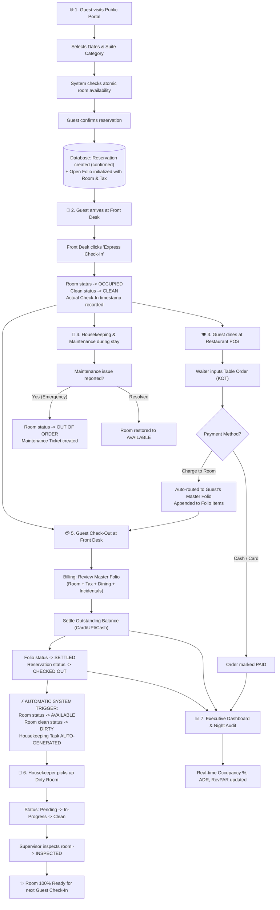
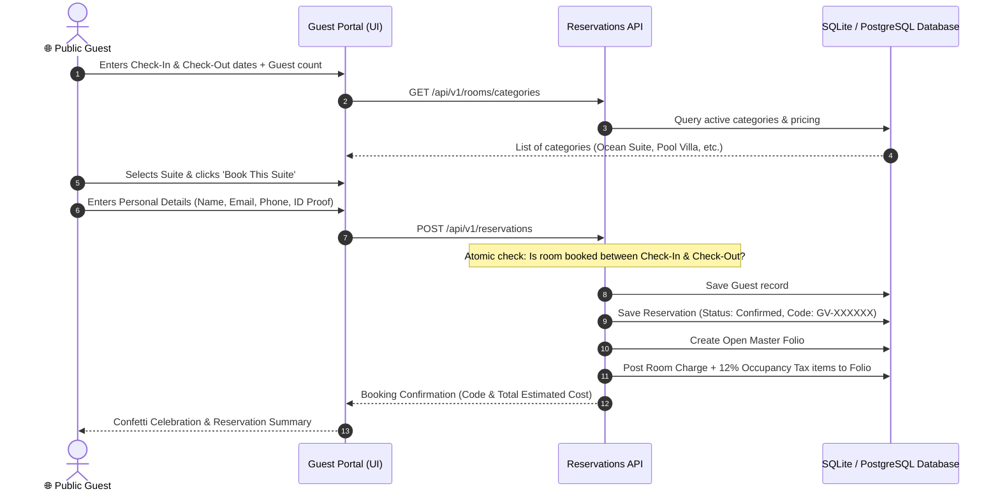
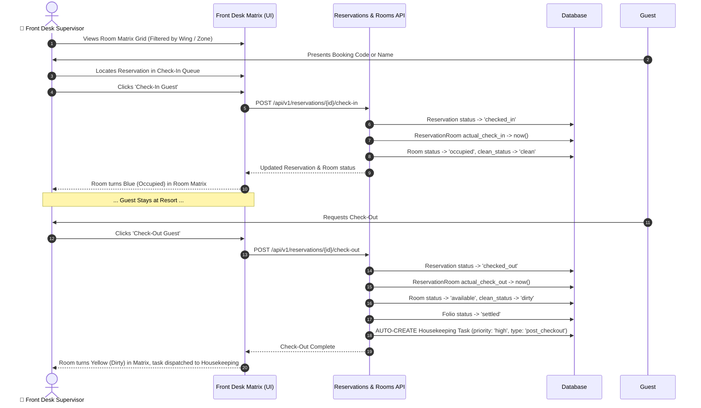
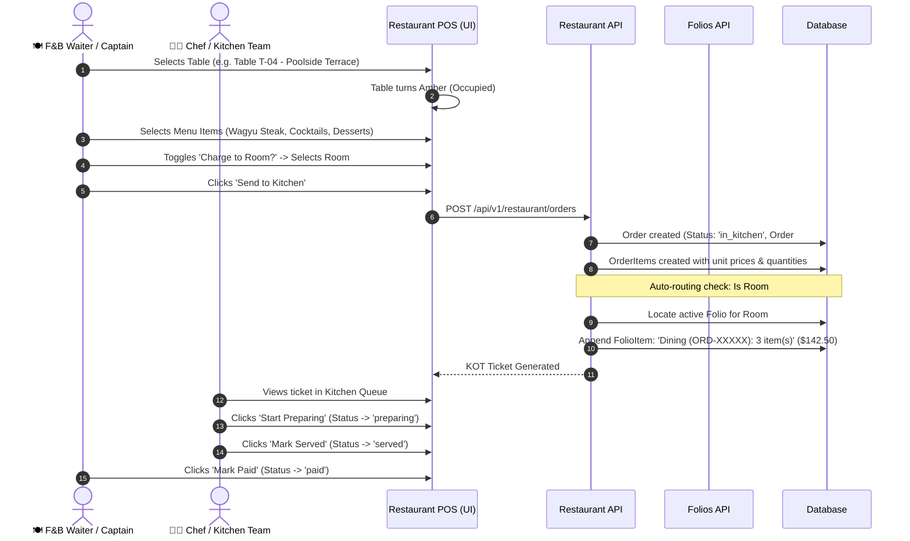
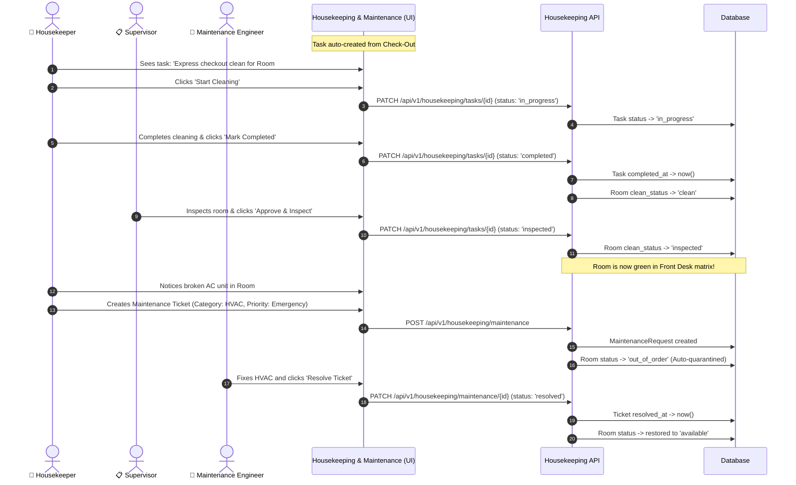
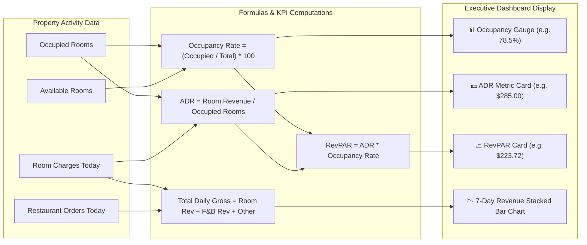

# Grand Vista Resort & Hotel PMS — Complete End-to-End User Flow & Operational Guide

---

## 📖 Executive Summary
The **Grand Vista Resort & Hotel PMS** is an enterprise hospitality platform connecting customer-facing bookings, front desk operations, food & beverage dining POS, housekeeping room turns, master guest folios, and executive night audit analytics.

This document outlines **how each user enters the system**, **the exact sequential process they follow**, **how data flows between departments**, and **how automatic system triggers work**.

---

## 👥 System Actors & Personas

```
┌─────────────────────────────────────────────────────────────────────────────┐
│                            HOSPITALITY ACTORS                               │
├──────────────────────┬──────────────────────────────────────────────────────┤
│ 1. Public Guest      │ Browses suites, books dates, pays deposits.          │
│ 2. Front Desk        │ Express check-in/out, room allocation, keycards.     │
│ 3. F&B Captain       │ Table seating, KOT kitchen tickets, room billing.    │
│ 4. Housekeeping Lead │ Room cleaning status, supervisor inspection, repairs.│
│ 5. Billing / Finance │ Consolidated folios, tax calculations, settlements.  │
│ 6. General Manager   │ Executive KPIs, ADR/RevPAR analytics, night audit.   │
└──────────────────────┴──────────────────────────────────────────────────────┘
```

---

## 🗺️ Master System Flowchart



---

## 🔄 Detailed Phase-by-Phase Process Flows

---

### Phase 1: The Public Guest Journey (Booking & Reservation)

#### Flow Summary
A prospective traveler visits the website, discovers available luxury villas or suites, selects travel dates, reviews calculated taxes, and reserves their stay.



#### Step-by-Step Breakdown:
1. **Portal Visit**: Guest lands on `http://localhost:5173/` and enters the **Guest Portal**.
2. **Date & Suite Search**:
   - Guest inputs Check-In Date and Check-Out Date.
   - The UI computes number of nights dynamically.
   - Shows live room cards with photos, square footage, bed configuration, and amenities.
3. **Collision Detection**:
   - The backend validates that `check_in_date < check_out_date`.
   - Checks `ReservationRoom` records to guarantee the room is not already allocated for those dates.
4. **Automated Folio Generation**:
   - Upon reservation confirmation, the system creates an initial **Master Folio** (`status='open'`).
   - Line items added automatically:
     - `Room Charge: #101 (Deluxe Ocean Suite) - 3 Night(s)`
     - `Resort Occupancy Tax & Service (12%)`
5. **Guest Output**: Guest receives a unique booking reference code (e.g. `GV-K83D2A`).

---

### Phase 2: Front Desk Operations (Check-In & Check-Out)

#### Flow Summary
The guest arrives at the resort. Front Desk locates the booking, verifies identification, allocates keycards, executes 1-click Express Check-In, and later manages Express Check-Out.



#### Step-by-Step Breakdown:
1. **Front Desk Room Matrix**:
   - Live grid displays all rooms color-coded:
     - 🟢 **Available** (Clean & unreserved)
     - 🔵 **Occupied** (Guest in-house)
     - 🟣 **Reserved** (Confirmed booking awaiting arrival)
     - 🔴 **Out of Order** (Maintenance emergency)
     - 🟡 **Dirty** (Awaiting housekeeping turn)
2. **Express Check-In Execution**:
   - Front Desk supervisor clicks **"Check In"**.
   - Room is marked `occupied`.
   - Keycard code is recorded.
3. **Express Check-Out & Auto-Trigger**:
   - When **"Check Out"** is clicked, the system:
     - Sets room status to `available`.
     - Automatically flags room cleanliness as `dirty`.
     - **Instantly dispatches a priority cleaning ticket** into the Housekeeping Lead's queue without manual phone calls or paper slips.

---

### Phase 3: Restaurant & Bar POS (Dining & Room Charges)

#### Flow Summary
In-house and walk-in guests order meals or cocktails at dining tables or by the pool. Orders are tracked via digital Kitchen Order Tickets (KOT) and can be paid directly or routed to the room folio.



#### Step-by-Step Breakdown:
1. **Table Map Selection**:
   - Waiter views tables organized by zone:
     - *Main Dining Hall*, *Poolside Terrace*, *Rooftop Sunset Lounge*, *Sunset Bar*.
2. **Ordering & Digital KOT**:
   - Waiter adds dishes with quantities and preparation notes.
   - 8% F&B sales tax is automatically computed.
3. **Automated Room Charge Routing (Zero Reconciliation)**:
   - When **"Charge to Room"** is checked, the backend matches the room number with the checked-in guest's active master folio.
   - The total amount is posted directly to the guest's hotel bill in real time.
   - Front Desk instantly sees the dining charge if the guest asks for their balance.
4. **Kitchen Order Ticket Workflow**:
   - `in_kitchen` ➔ `preparing` ➔ `served` ➔ `paid`.

---

### Phase 4: Housekeeping & Facilities Maintenance

#### Flow Summary
Housekeeping staff manage cleanliness turnovers, while engineering logs repair tickets. Emergency maintenance automatically quarantines rooms to prevent double-booking damaged assets.



#### Cleanliness Queue States:
| State | Badge Color | Meaning |
|---|---|---|
| **Dirty** | 🟡 Yellow | Guest checked out or daily turnover pending. |
| **In Progress** | 🔵 Blue | Housekeeper is actively servicing the room. |
| **Clean** | 🟢 Green | Room cleaned, awaiting final inspection. |
| **Inspected** | 🟢 Deep Green | Supervisor approved. 100% ready for check-in. |

#### Maintenance Priority Logic:
- **Low / Medium / High**: Logged for engineer dispatch; room remains available.
- **Emergency Priority**: System **automatically overrides room status to `out_of_order`**, blocking Front Desk from checking anyone into that room until the engineer marks the ticket `resolved`.

---

### Phase 5: Master Folios, Invoicing & Financial Settlement

#### Flow Summary
Every charge incurred across all resort departments (room stay, dining, minibar, spa, occupancy taxes) consolidates into a single unified guest folio.

```
┌────────────────────────────────────────────────────────────────────────┐
│                        CONSOLIDATED MASTER FOLIO                       │
├────────────────────────────────────────────────────────────────────────┤
│  + Room Charges (# Nights x Base Rate)                                 │
│  + F&B Dining & Room Service (Auto-routed from POS)                    │
│  + Spa & Incidental Add-ons                                            │
│  + 12% Resort Occupancy Tax & Service Charge                           │
│  ────────────────────────────────────────────────────────────────────  │
│  = TOTAL ACCUMULATED CHARGES                                           │
│  - Less: Advance Deposits & Recorded Payments                          │
│  ────────────────────────────────────────────────────────────────────  │
│  = BALANCE DUE (Must reach $0.00 to complete check-out settlement)     │
└────────────────────────────────────────────────────────────────────────┘
```

#### Settlement Methods Supported:
- 💳 **Credit / Debit Card** (Visa, MasterCard, Amex)
- 📱 **UPI / QR Code Scan**
- 💵 **Cash at Desk**
- 🏦 **Corporate Bank Wire Transfer**

#### Invoicing:
- One-click **"Print Receipt / Invoice"** formats an official receipt complete with receipt number, guest passport/ID details, itemized breakdown, tax registration, and payment reference numbers.

---

### Phase 6: Executive Analytics & Night Audit

#### Flow Summary
General Managers, Revenue Directors, and Night Auditors monitor real-time property performance through live operational metrics and 7-day revenue trend charts.



---

## 🔐 Staff Role Permissions Matrix

The PMS includes an instant role-switcher at the bottom of the navigation sidebar:

| Feature / Screen | 👑 General Manager (`admin`) | 🚪 Front Desk Supervisor (`frontdesk`) | 🍽️ F&B Captain (`waiter`) | 🧹 Housekeeping Lead (`housekeeping`) |
|---|:---:|:---:|:---:|:---:|
| **Executive Dashboard & KPIs** | ✅ Full Access | ❌ Restricted | ❌ Restricted | ❌ Restricted |
| **Room Matrix & Check-in/out** | ✅ Full Access | ✅ Primary Tool | ❌ Restricted | 👁️ View Only |
| **New Booking Creation** | ✅ Full Access | ✅ Primary Tool | ❌ Restricted | ❌ Restricted |
| **Restaurant POS & Table Map** | ✅ Full Access | 👁️ View Folio Charges | ✅ Primary Tool | ❌ Restricted |
| **Kitchen Order Tickets (KOT)** | ✅ Full Access | ❌ Restricted | ✅ Primary Tool | ❌ Restricted |
| **Housekeeping Clean Queue** | ✅ Full Access | 👁️ View Clean Status | ❌ Restricted | ✅ Primary Tool |
| **Maintenance Engineering** | ✅ Full Access | ✅ Report Tickets | ❌ Restricted | ✅ Manage & Resolve |
| **Master Folio & Billing** | ✅ Full Access | ✅ Settle & Print | 👁️ View Room Charge | ❌ Restricted |
| **Public Guest Portal** | ✅ Accessible | ✅ Accessible | ✅ Accessible | ✅ Accessible |

---

## ⚡ Cross-Department Trigger Reference Table

This table illustrates what happens across the entire property when an action occurs in one department:

| Initial Action Taken | Primary Module | Triggered Side Effect | Impacted Department |
|---|---|---|---|
| Guest creates reservation online | Public Portal | Creates Reservation + Pre-allocates Master Folio with room charge + 12% tax | Front Desk & Accounting |
| Front desk clicks "Check-In" | Front Desk | Room status changed to `occupied`; Check-in timestamp recorded | Housekeeping & Operations |
| Waiter selects "Charge to Room" | Restaurant POS | Dining bill appended to guest's hotel bill immediately | Front Desk & Billing |
| Front desk clicks "Check-Out" | Front Desk | Room set to `available`, clean status set to `dirty`; Folio marked `settled` | Front Desk & Accounting |
| Check-out completion | System Trigger | **Auto-creates high priority cleaning task** in queue | Housekeeping |
| Housekeeper marks "Complete" | Housekeeping | Room clean status updated to `clean` | Front Desk Matrix |
| Supervisor marks "Inspected" | Housekeeping | Room clean status updated to `inspected` (Ready for arrival) | Front Desk Matrix |
| Emergency repair ticket logged | Housekeeping / Eng | Room status forced to `out_of_order`; cannot be booked | Front Desk & Reservations |
| Engineer marks ticket "Resolved" | Maintenance | Room status restored to `available` | Front Desk Matrix |
